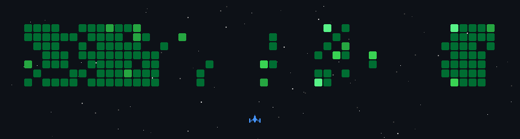

<!--
  MAHESH G | GITHUB PROFILE README
  Design: Midnight / Neon / Engineering Universe
-->

<div align="center">


<br/>


<br/>

<a href="https://github.com/GMahesh007">

</a>
&nbsp;
<a href="https://github.com/GMahesh007?tab=followers">

</a>

<br/><br/>

**I don't just write code. I engineer solutions.**

*Building the future, one commit at a time.*

</div>

---

<div align="center">

## ◈ THE DEVELOPER BEHIND THE CODE

</div>

```python
class Mahesh:
    def __init__(self):
        self.name = "Mahesh G."
        self.role = "Software Engineer"
        self.company = "Finkraft.AI"
        self.location = "Bengaluru, India"

        self.focus = [
            "Backend Engineering",
            "Microservices & REST APIs",
            "Cloud Infrastructure",
            "AI-powered Applications"
        ]

        self.languages = ["Python", "Java", "JavaScript", "SQL"]

    def mission(self):
        return "Build. Optimize. Innovate. Repeat."

developer = Mahesh()
```

<details>
<summary><b>⚡ A little more about my engineering journey</b></summary>
<br/>

- 💼 Software Engineer at **Finkraft.AI**
- 🧠 Developing Python backend microservices and REST APIs.
- ☁️ Working with AWS, Azure, PostgreSQL and MongoDB.
- 🤖 Interested in AI, NLP, automation and distributed systems.
- 🎓 MCA Graduate from PES University.
- 🏆 Secured 5th University Rank in BCA at Bangalore City University.

</details>

---

<div align="center">

## ◈ MY TECHNOLOGY UNIVERSE

*Tools are just instruments. Engineering is the art.*

</div>

<table align="center">
<tr>
<td align="center" width="50%">

### ⚙️ Backend Engineering


</td>
<td align="center" width="50%">

### ☁️ Cloud & Infrastructure


</td>
</tr>
<tr>
<td align="center" width="50%">

### 🗄️ Data & Databases


</td>
<td align="center" width="50%">

### 🛠️ Development Tools


</td>
</tr>
</table>

<div align="center">

**ALSO EXPLORING**

`Apache Hadoop` &nbsp; `Apache Spark` &nbsp; `Apache Flink` &nbsp; `RabbitMQ` &nbsp; `NLP`

</div>

---

<div align="center">

## ◈ THE ENGINEERING LOG

*Where ideas turn into working software.*

</div>

<table>
<tr>
<td width="50%" valign="top">

### 💼 PROFESSIONAL EXPERIENCE

**01 / Software Engineer**

`Finkraft.AI`

📍 Bengaluru | Sep 2025 – Present

- Python backend microservices.
- REST APIs for airline and hotel booking workflows.
- PostgreSQL & MongoDB query optimization.
- AWS & Azure deployments.

</tr>
</table>

---

<div align="center">

## ◈ SELECTED WORKS

*Some things I've built along the way.*

</div>

<table>
<tr>
<td width="50%" valign="top">

<div align="center">

### 🚀 SMART JOBX


</div>

An AI-powered job referral and skill analysis platform.

**Inside the project:**

- NLP-based resume parsing.
- Skill gap analysis.
- Recruiter and candidate workflows.
- Mock assessment engine.
- JWT & Google OAuth authentication.

**Stack:** React · Node.js · Express · MongoDB

<div align="center">

[EXPLORE PROJECT ↗](https://github.com/GMahesh007/Smart-JobX)

</div>

</td>
<td width="50%" valign="top">

<div align="center">

### 🌐 SOFTWARE NETWORK


</div>

A centralized team communication and project tracking system.

**Inside the project:**

- Project and task management.
- Team collaboration workflows.
- Responsive web interfaces.
- Database-driven user management.
- End-to-end SDLC involvement.

**Stack:** HTML · CSS · JavaScript · MySQL · SQL Server

<div align="center">

[EXPLORE PROJECT ↗](https://github.com/GMahesh007/Software-Network)

</div>

</td>
</tr>
</table>

---

<div align="center">

## ◈ GITHUB COMMAND CENTER

*Every contribution is another step forward.*



<!-- <br/>


<br/><br/>


<br/><br/>


</div> -->

---

<div align="center">

## ◈ BEYOND THE TERMINAL

### 🎓 Milestones & Certifications

| Achievement | Recognition |
|:---|:---|
| 🏆 Academic Excellence | 5th University Rank – BCA |
| ☁️ Cloud | AWS Cloud Practitioner Essentials |
| 🤖 Robotics | Automotive Skills Development Council (ASDC) |

</div>

---

<div align="center">

## ◈ ESTABLISH CONNECTION

*Good conversations lead to great collaborations.*

<br/>

<a href="https://www.linkedin.com/in/gmaheshdev07/">

</a>
<a href="mailto:gmahesh.hireme@gmail.com">

</a>
<a href="https://gmahesh007.github.io/Personal_Portfolio07-/">

</a>

<br/><br/>

<a href="https://leetcode.com/u/MaheshMayu07/">

</a>
<a href="https://www.geeksforgeeks.org/user/maheshg007/">

</a>
<a href="https://x.com/Mahesh_Mahii_07">

</a>

<br/><br/>


**`while(alive) { learn(); build(); innovate(); }`**

<sub>Designed with curiosity. Built with code. Powered by coffee. ☕</sub>

</div>
